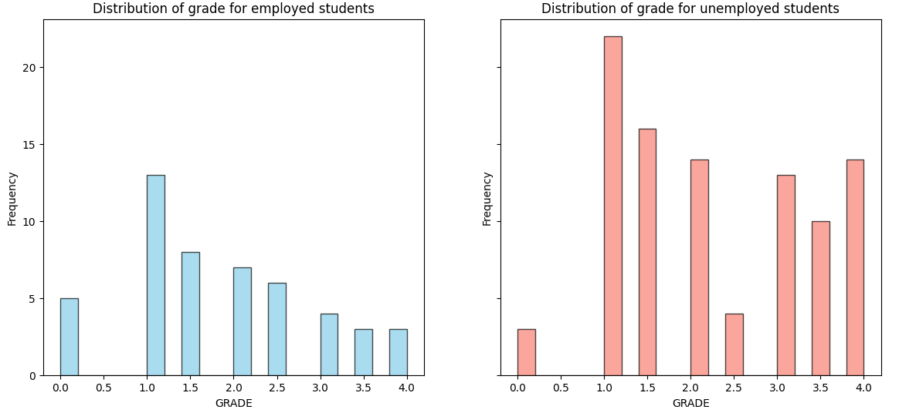
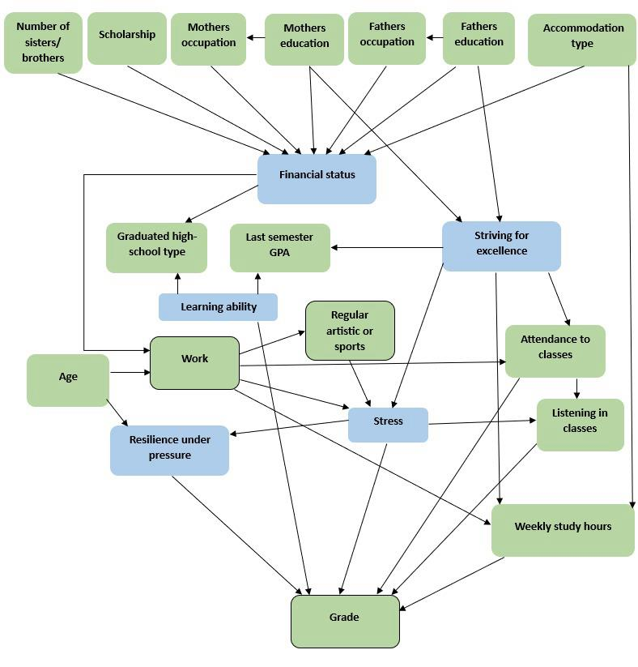

# Does Working During College Affect Students' Grades? A Causal Inference Study

[](https://colab.research.google.com/github/OmriSavir/causal-inference-final-project/blob/main/casual_inference_final_project.ipynb)

Final project for **Introduction to Causal Inference (097400)**, Technion.
**Authors:** Omri Savir, Anna Gurevich

This project estimates the **causal effect of student employment on final course grades** using observational data. We build a causal graph from domain knowledge, state the identification assumptions, and estimate the Average Treatment Effect (ATE) with several methods: Inverse Propensity Weighting (IPW), matching, S/T/R meta-learners and a Causal Forest.

---

## Research question

Working students get lower grades on average. Is that gap **caused** by working, or is it explained by confounders such as age or socioeconomic background?

In an ideal randomized controlled trial (RCT), students would be randomly assigned to work or not work for one semester, and their exam grades would be compared. Since an RCT isn't feasible, we rely on observational data and causal inference methods.

- **Null hypothesis (H0):** working during studies does not affect the final grade.
- **Alternative hypothesis (H1):** working during studies decreases the final grade.

## Data

- **Source:** *Higher Education Students Performance Evaluation* dataset (Yilmaz & Şekeroğlu, 2019), [UCI Machine Learning Repository](https://archive.ics.uci.edu/dataset/856/higher+education+students+performance+evaluation), licensed CC BY 4.0. The file in this repository comes from the [Kaggle mirror](https://www.kaggle.com/datasets/joebeachcapital/students-performance).
- **Size:** 145 students from Cyprus. Each record covers demographics, family and socioeconomic background, lifestyle, study habits, previous GPA and the course grade.
- **Treatment (T):** `Additional work`, a binary indicator of whether the student worked during the semester. 34% of students worked (49) and 66% did not (96).
- **Outcome (Y):** the final course grade, converted from letter grades to a 0–4 scale:
  `Fail: 0, DD: 1, DC: 1.5, CC: 2, CB: 2.5, BB: 3, BA: 3.5, AA: 4`

**Pre-processing:** almost all variables are categorical (for example, age is binned as 18–21, 22–25, 26+), so categorical variables were one-hot encoded. Scholarship was mapped to a numeric fraction (0–1).

### Naive comparison

| Group | Mean grade |
|---|---|
| Employed | 1.806 |
| Not employed | 2.229 |
| **Difference** | **−0.423** |



## Identification

### Causal graph

The graph below encodes our domain assumptions. **Green** nodes are observed in the data. **Blue** nodes are unobserved (latent).



In this graph, work has no direct edge to the grade. It affects the grade only through mediators such as class attendance, weekly study hours, stress, and resilience under pressure. Most of these paths are expected to lower grades, while the resilience path may raise them.

### Timeline and post-treatment variables

We treat the beginning of the semester as the start of the treatment and the exam at its end as the outcome. Variables that describe behavior during the semester can be affected by working, so they were **excluded** as post-treatment variables:

`Total salary`, `Transportation to the university`, `Attendance to classes`, `Weekly study hours`, `Listening in classes`, `Regular artistic or sports activity`, `Attendance to seminars/conferences`, `Preparation to midterm exams 2`, `Taking notes in classes`

### Adjustment set

After removing post-treatment variables, we computed a minimal d-separator between `Work` and `Grade` with `networkx.find_minimal_d_separator`. The result is **{Age}**, the minimal set that blocks all backdoor paths in our graph.

### Assumptions

- **SUTVA:** one student's employment does not affect another student's grade.
- **Consistency:** the observed outcome is the potential outcome under the treatment actually received.
- **Overlap (positivity):** every covariate profile has a positive probability of both working and not working.
- **No unmeasured confounding:** given the adjustment set, no confounding path remains, according to the causal graph.

## Estimation methods

| Method | Description |
|---|---|
| **IPW** | Propensity scores e(x) = P(T=1 \| X=x) estimated with a Random Forest classifier on age, scholarship, number of siblings, accommodation type, and mother's and father's occupation |
| **Matching** | 1-nearest-neighbor matching of treated students to control students on all pre-treatment covariates, using four distance metrics: Euclidean, Manhattan, Jaccard and cosine |
| **S-learner** | A single outcome model on (X, T). The effect is the difference between predictions with T=1 and T=0 |
| **T-learner** | Separate outcome models for treated and control students. The effect is the difference between their predictions |
| **R-learner** | A residual-based learner that combines an outcome model with the propensity scores |
| **Causal Forest** | `CausalForestDML` from EconML |

For the meta-learners, the base model is drawn **at random** in every run from a pool of four regressors: Gradient Boosting, XGBoost, Random Forest and SVR. The goal is that conclusions don't depend on a single model. As a result, point estimates change from run to run, so we report bootstrap results instead.

**Uncertainty:** 95% confidence intervals come from **1,000 bootstrap resamples**, using the 2.5th and 97.5th percentiles. For each method we also report the share of bootstrap replicates whose estimate was ≤ 0.

## Results

| Method | Point estimate | 95% bootstrap CI | Share of bootstrap estimates ≤ 0 |
|---|---|---|---|
| IPW | −0.047 | [−0.959, 0.993] | 0.552 |
| S-learner | – | [−0.283, 0.020] | 0.903 |
| T-learner | – | [−0.725, 0.099] | 0.908 |
| R-learner | – | [−0.307, 0.099] | 0.717 |
| Causal Forest | – | [−0.892, 0.143] | 0.919 |

| Matching metric | Estimate |
|---|---|
| Euclidean | −0.184 |
| Manhattan | −0.051 |
| Jaccard | 0.031 |
| Cosine | −0.031 |

- The intersection of the five confidence intervals is **[−0.283, 0.020]**. Their union is **[−0.959, 0.993]**.
- **Every confidence interval contains zero, so we cannot reject H0 at the 95% level.**

## Conclusions

- Most methods point to a **negative** effect of working on grades. In the S-learner, T-learner and Causal Forest, more than 90% of the bootstrap estimates are ≤ 0.
- The **size** of the effect varies across methods. The S-learner, R-learner and most matching variants suggest a small effect, while the T-learner and Causal Forest suggest a larger decline.
- IPW gives by far the widest interval.
- Overall, the evidence is **not strong enough to conclude a causal effect** of employment on grades in this dataset.

## Limitations

- **Small sample (n = 145):** wide confidence intervals, sensitivity to individual observations, and only limited use of methods such as matching.
- **Binary treatment:** the analysis ignores working hours, job type and whether the job is related to the field of study.
- **Unobserved factors:** stress, striving for excellence and learning ability appear in the graph but are not measured.
- **Single institution and country:** results may not generalize.
- **Random base-learner selection:** meta-learner point estimates are not reproducible from run to run.

**Future work:** data from more institutions, a continuous treatment (hours worked or employment percentage), and conditional effects (CATE) across subgroups.

## Repository contents

```
casual_inference_final_project.ipynb   # full analysis notebook (with outputs)
StudentsPerformance_with_headers.csv   # dataset
images/                                # figures used in this README
```

**Notebook sections:**

1. Data loading and exploratory analysis: distributions, normality tests, and grades by course
2. Pre-processing
3. IPW
4. S-learner (plus an exploratory variant with treatment interactions)
5. T-learner
6. R-learner
7. Causal Forest
8. Combined confidence intervals
9. Matching
10. An exploratory instrumental-variable estimate
11. Causal graph construction and adjustment-set search with `networkx`

## How to run

The notebook was developed in **Google Colab**.

1. Click the **Open in Colab** badge at the top of this page.
2. Run the cells in order. The first cell installs `econml`. The second cell opens a file-upload dialog: upload `StudentsPerformance_with_headers.csv` from this repository.
3. Note that the bootstrap sections run 1,000 iterations per method. The Causal Forest bootstrap is the slowest.

**Main dependencies (versions used in Colab):** Python 3.10, numpy 1.26.4, pandas 2.2.2, scikit-learn 1.5.2, scipy 1.13.1, econml 0.15.1, xgboost, networkx (3.3+, required for `find_minimal_d_separator`), matplotlib, seaborn.

## References

- Ehrenberg, R. G., & Sherman, D. R. (1987). Employment while in college, academic achievement, and postcollege outcomes: A summary of results. *Journal of Human Resources, 22*(1), 1–23.
- Stinebrickner, R., & Stinebrickner, T. R. (2003). Working during school and academic performance. *Journal of Labor Economics, 21*(2), 473–491.
- Nie, X., & Wager, S. (2021). Quasi-oracle estimation of heterogeneous treatment effects. *Biometrika, 108*(2), 299–319.
- Wager, S., & Athey, S. (2018). Estimation and inference of heterogeneous treatment effects using random forests. *Journal of the American Statistical Association, 113*(523), 1228–1242.
- Yilmaz, N., & Şekeroğlu, B. (2019). *Higher Education Students Performance Evaluation* [Dataset]. UCI Machine Learning Repository. https://doi.org/10.24432/C51G82
